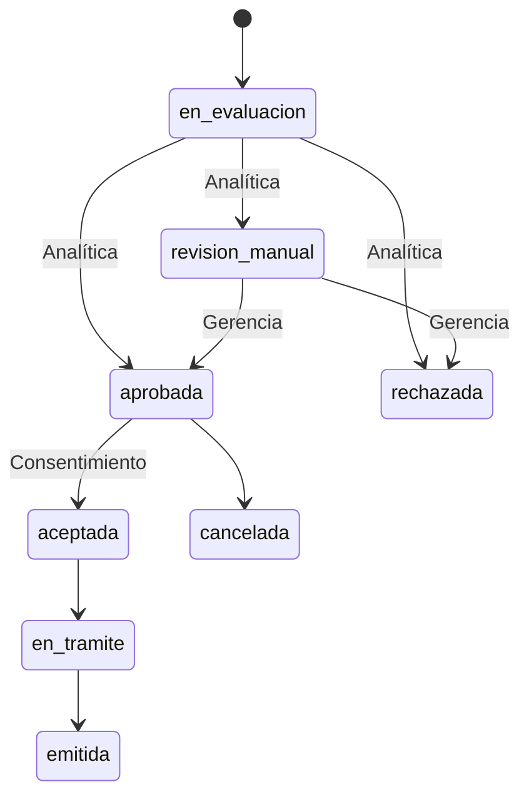

# Integración del ecosistema CreditPulse

Contrato de CP Gestiones, versión 1.2.0. Los otros dos sistemas todavía no están conectados. Registro y login central están documentados en [REGISTRO-BANCA.md](REGISTRO-BANCA.md). El flujo Banca → Gestiones al final de esta guía describe la recepción de ofertas aceptadas y la asignación manual del límite. El equipo debe integrar y verificar estos contratos entre sus servidores.

## Responsabilidades

- **CP Gestiones:** identidad y credenciales de clientes, cuentas, saldos, movimientos, catálogo, gestiones, emisión simulada, créditos autorizados, tarjetas, planillas y bitácora.
- **CP Analítica:** análisis crediticio y resultado de riesgo. Gestiones conserva su referencia y el límite autorizado; no calcula un score sustitutivo.
- **CP Banca Virtual:** formularios de registro y acceso, presentación de productos y consentimiento. Su servidor valida la sesión central y consume Gestiones con una credencial privada de integración.

Cada sistema debe consumir HTTP. No se comparte acceso directo a MongoDB ni se colocan tokens de integración en el JavaScript del navegador.

## Archivos para compartir

Importa `openapi.json` en un visor OpenAPI 3.1. En Postman importa `CP-Gestiones.postman_collection.json`; contiene las 51 rutas de esta versión. El grupo `banca` utiliza la variable privada `bankToken`. Configura las variables localmente. No exportes contraseñas ni tokens en una colección compartida.

URL local: `http://127.0.0.1:8001/api/v1`. En línea se debe usar HTTPS. La sesión del panel usa un token opaco revocable, no JWT; esto permite invalidarlo inmediatamente al cambiar permisos o cerrar sesión.

## Autenticación

`POST /auth/login` recibe `email` y `password`. La respuesta incluye `data.token`, `data.user` y `data.permissions`. Envía `Authorization: Bearer <token>` y `Accept: application/json` en las siguientes peticiones. La sesión de un empleado vence a los 60 minutos. Cinco contraseñas incorrectas bloquean el acceso durante 15 minutos. `POST /auth/logout` revoca la sesión actual.

Desde la terminal del backend, un operador autorizado genera credenciales de integración:

```text
php artisan cp:token banca
php artisan cp:token riesgos
```

El comando muestra el secreto una sola vez; MongoDB conserva su hash. Estos tokens duran 30 días. Para revocar todos los tokens de una integración: `php artisan cp:revoke banca` o `php artisan cp:revoke riesgos`. La emisión del reemplazo no revoca automáticamente el anterior. No se incluyeron credenciales de integración en la entrega.

El token de riesgos tiene acceso a pendientes y decisiones. El token de banca tiene permisos limitados para clientes, productos, cuentas, transferencias, solicitudes y tarjetas. Ninguno concede administración de usuarios ni acceso general a la bitácora. La decisión de riesgo exige específicamente la identidad `service:riesgos`, incluso cuando quien llama tiene rol administrador.

### Identidad del cliente de Banca Virtual

Para nuevas altas desde banca usa `POST /banca/registro`: crea cliente, hash de contraseña y primera cuenta de ahorro juntos. Recibe `cliente_ref`, que se conserva internamente como `external_ref`; Gestiones guarda y valida las credenciales mediante `/banca/auth/login`. `POST /clientes` sigue disponible para altas asistidas del portal, con su contrato anterior, y no abre una cuenta ni habilita acceso central automáticamente. Para consultar o actuar sobre cuentas, gestiones o tarjetas, banca envía `cliente_ref` en la consulta GET o en el cuerpo JSON de las escrituras.

**El servidor de Banca Virtual debe obtener esta referencia de su sesión autenticada.** No debe aceptar del navegador una referencia arbitraria. Gestiones verifica que los recursos pertenezcan al cliente indicado; como se utiliza una credencial de servidor compartida, confía en que ese servidor autentica correctamente a su usuario final.

Ejemplo: `GET /cuentas?cliente_ref=cliente-ficticio-001`. Una petición de banca sin referencia o contra una cuenta de otro titular se rechaza. La referencia no es un token ni sustituye el encabezado de autorización.

## Convenciones

- Importes de operaciones monetarias como texto decimal: `"1500.25"`. No enviar números JSON flotantes, separadores de miles, signos negativos ni notación científica. Excepción explícita: `ingresos_mensuales_q` en las nuevas rutas de banca admite texto o número JSON con máximo dos decimales. Ingresos y deudas declarados admiten cero.
- Importes persistidos y devueltos en campos terminados en `_centavos`: enteros. Por ejemplo, `150025` representa Q1,500.25. No sumar saldos usando `float`.
- Moneda implementada: GTQ. Tasas en puntos básicos: `365` equivale a 3.65 % anual.
- Identificadores internos: cadenas ObjectId de 24 caracteres hexadecimales. Las cuentas tienen además un `numero` visible.
- Cada escritura de negocio requiere `Idempotency-Key`, de 8 a 120 caracteres alfanuméricos o `_.:-`. Se excluyen login, logout y marcar alertas como leídas.
- Usa una clave nueva por operación. Conserva la misma clave, URL y cuerpo al reintentar por timeout. Reutilizarla con datos distintos devuelve `409 IDEMPOTENCY_MISMATCH`.
- La clave se vincula al actor, por lo que debe ser única entre sus operaciones. El servidor de banca debe generarla y conservarla junto con la operación del cliente. La colección Postman deja esta decisión visible: cambia `idempotencyKey` antes de iniciar otra operación, no durante un reintento.
- Un `409` por concurrencia puede requerir reintentar con la misma clave. Un conflicto de estado o versión requiere consultar el recurso y revisar la acción antes de enviar una operación nueva.
- Respuesta normal: `{"ok":true,"data":...}`. Las listas generales tienen paginación dentro de `data`: `data.data`, `current_page`, `last_page`, `per_page`, `total`.
- Listas generales: `page` y `per_page` (máximo 100). Los movimientos, estados de cuenta y pendientes de riesgo usan tamaños establecidos por el servidor.
- Errores: mensaje, código y, cuando corresponde, errores por campo. `401` sesión inválida, `403` falta de permiso o titularidad, `404` recurso inexistente, `409` conflicto de negocio, `422` validación, `429` límite de peticiones, `503` base no disponible. No se exponen trazas al consumidor.

## Flujo de tarjeta de crédito

1. Banca o un empleado registra `POST /solicitudes` con `cliente_id`, `producto` (`credito-clasica`, `credito-oro` o `credito-platino`) y `limite_solicitado`. Banca incluye `cliente_ref`. El resultado contiene `id`, `estado` y `version`. Se impide otra solicitud activa del mismo producto para ese cliente.
2. Analítica consulta `GET /riesgos/pendientes`. Incluye perfil declarado del cliente y saldo de cuentas; no contiene información de burós ni historial de otros bancos. Alternativamente, puede recibir un evento si se configura su URL.
3. Analítica envía `POST /solicitudes/{id}/decision-riesgo`, con su token y una clave de idempotencia. Ejemplo sintético:

```json
{
  "version": 1,
  "resultado": "aprobada",
  "limite_aprobado": "8000.00",
  "referencia": "EVAL-DEMO-001",
  "motivo": "Respuesta sintética para probar el contrato"
}
```

Los resultados posibles son `aprobada`, `rechazada` y `revision_manual`. Aprobación y revisión manual requieren un límite positivo que no exceda el solicitado. Rechazo admite `"0.00"`. La versión debe coincidir con la actual; cada cambio la incrementa.

4. Una revisión manual requiere resolución de gerencia o administración. Esta resolución conserva el máximo autorizado por el motor.
5. La aceptación del cliente se registra mediante `POST /solicitudes/{id}/transiciones` con `estado=aceptada`, versión actual, nota y `referencia_aceptacion`. Banca debe guardar la evidencia real del consentimiento; una referencia escrita no prueba por sí misma identidad ni firma legal.
6. Gerencia o administración pasa a `en_tramite` y después a `emitida`. Para crédito el operador debe enviar `limite_asignado` positivo y no superior al máximo de Analítica. Se crea una sola tarjeta con ese límite y condiciones copiadas del producto. No se admiten saltos de estado ni emisiones duplicadas por reintento.



La solicitud de débito exige una cuenta activa del titular y comienza en `aprobada`; no requiere riesgo de crédito. El resto de su trámite conserva aceptación, emisión y bitácora. Las tarjetas usan una referencia de simulación y cuatro dígitos visibles, sin PAN ni CVV de una red de pagos.

## Cuentas, tarjetas y planillas

- `POST /cuentas` abre con saldo cero. `POST /caja` registra depósitos/retiros contra la caja interna; requiere un empleado autorizado. No hay una ruta para asignar saldo libremente.
- `POST /transferencias` recibe `origen_id`, el destino como `destino_id` (ID interno) **o** `destino_numero` (10 dígitos sin guiones, el que escribe el cliente en Banca), `monto`, `concepto` y, para banca, `cliente_ref`. El origen debe ser del cliente autenticado. El destino puede ser otra cuenta activa de este banco; un número inexistente responde `404 ACCOUNT_NOT_FOUND`. No existe liquidación interbancaria.
- `POST /tarjetas/{id}/consumos` carga crédito hasta el límite o debita la cuenta asociada si es débito.
- `POST /tarjetas/{id}/pagos` exige una cuenta del titular y no permite exceder la deuda. Aplica a intereses y luego capital. Consulta cortes con `GET /tarjetas/{id}/estados-cuenta`.
- `POST /empresas` vincula una cuenta y al menos dos miembros corporativos, incluyendo operador y aprobador. Una cuenta no puede pertenecer a dos empresas.
- `POST /planillas` recibe `empresa_id`, `nombre` y hasta 500 `pagos`, cada uno con `nombre`, `monto` y `cuenta_numero` o `cuenta_id`. No permite beneficiarios duplicados. Los usuarios corporativos solo acceden a empresas de las que son miembros.
- `POST /planillas/{id}/autorizar` exige una persona distinta de quien cargó la planilla. La deja `en_cola`. El trabajador aplica toda la dispersión en una transacción; si falla una cuenta, ninguna recibe fondos. Un lote pagado no se procesa de nuevo.

## Eventos y procesos en segundo plano

Variables en el `.env` del backend:

```dotenv
RISK_API_URL=
RISK_API_TOKEN=
BANK_WEBHOOK_URL=
BANK_WEBHOOK_SECRET=
```

`RISK_API_URL` es la URL completa que recibirá un POST `riesgo.solicitado`. `RISK_API_TOKEN` es una credencial emitida por Analítica para aceptar ese POST; **no es** el token `cp:token riesgos` emitido por Gestiones para recibir decisiones. La respuesta HTTP al evento confirma recepción; la decisión llega por la ruta explícita de callback. El motor puede consultar el perfil por la API de pendientes.

`BANK_WEBHOOK_URL` recibe cambios de solicitud con el formato:

```json
{
  "event_id": "uuid-del-evento",
  "type": "solicitud.actualizada",
  "data": {
    "solicitud_id": "0123456789abcdef01234567",
    "estado": "aprobada",
    "sequence": 2,
    "nota": "Decisión registrada"
  }
}
```

Se envía `Idempotency-Key: <event_id>`. Banca debe deduplicar por `event_id` y aplicar solo secuencias mayores a la última recibida para la solicitud, pues los reintentos pueden alterar el orden de entrega.

El webhook de banca lleva `X-CP-Timestamp` (segundos Unix) y `X-CP-Signature`. Verifica con comparación de tiempo constante el HMAC SHA-256 de `timestamp + "." + cuerpo_original`, usando el secreto compartido. Debe verificarse el cuerpo exacto recibido, antes de recodificar JSON; una política sugerida del receptor es tolerar cinco minutos de desfase y rechazar eventos repetidos por ID. Configura relojes sincronizados. La firma autentica al emisor, pero no cifra el cuerpo: usa HTTPS.

Los eventos se guardan junto con la operación en la misma transacción. Se consideran recibidos solo con HTTP 2xx. Hay hasta ocho intentos con espera creciente, tope de una hora, y recuperación de reservas vencidas. Sin configuración quedan pendientes. La entrega es **al menos una vez**, por lo que el receptor debe implementar deduplicación. `GET /integraciones` muestra pendientes y fallidos sin exponer secretos.

En desarrollo deja ejecutándose `php artisan schedule:work` desde `backend`. Programa planillas y eventos cada minuto y el cierre diario a las 23:59 de Guatemala. Este proceso no se inicia con el panel. También existen ejecuciones manuales:

```text
php artisan cp:payrolls
php artisan cp:outbox
php artisan cp:outbox-retry ID_INTERNO_DEL_EVENTO
php artisan cp:close-day
```

No ejecutes cierres históricos contra saldos actuales. La implementación solo cierra el día actual. Si una tarjeta o cuenta tiene un hueco desde su último cierre, esa sola queda en `pendientes` del resultado (requiere conciliación) y el resto se cierra normalmente. Las fórmulas, límites y exclusiones están en `DECISIONES.md`.

## Datos necesarios para la conexión real

Para cada compañero se requieren: URL de desarrollo, contrato OpenAPI o ejemplos HTTP, autenticación, identificadores estables, catálogo de productos y códigos de estado. Además, acordar quién conserva el consentimiento, cómo banca confirma recepción de eventos y cómo Analítica comunica una decisión definitiva.

Con esa información puede ajustarse el adaptador de Gestiones sin cambiar el código de sus sistemas, **si sus API existentes permiten las operaciones necesarias**. Si no ofrecen alguna operación, será necesario acordar una interfaz adicional. No se ha verificado compatibilidad ni disponibilidad de servicios externos.

## Flujo acordado: Banca → Gestiones (versión 1.2)

Este flujo recibe la oferta **ya evaluada y aceptada**. El flujo anterior `/solicitudes` sigue disponible para gestiones iniciadas desde el portal. No llamar ambos flujos para el mismo producto: se impide duplicar una gestión activa.

**1. Analítica publica su evaluación** con su token `riesgos`, `Idempotency-Key` y `POST /api/v1/riesgos/evaluaciones`:

```json
{
  "cliente_ref": "banca-juan-001",
  "evaluacion_ref": "eval-10030",
  "producto": "credito-personal",
  "resultado": "aprobada",
  "monto_solicitado": "10000.00",
  "limite_aprobado": "8500.00",
  "motivo": "Resultado de la evaluación de Analítica"
}
```

Solo Analítica puede enviar el máximo: Banca y los administradores reciben 403. La evaluación es inmutable; el mismo ID con datos diferentes devuelve 409. El resultado puede ser `aprobada` o `rechazada` (límite cero). Una evaluación rechazada no puede abrir un trámite aceptado. Los productos admitidos son los créditos del catálogo: tarjetas Clásica/Oro/Platino y `credito-personal`, `credito-vehicular`, `credito-hipotecario`. El cliente debe existir previamente en Gestiones.

**2. Banca registra la aceptación**, con su token `banca`, `Idempotency-Key` y `POST /api/v1/banca/gestiones`:

```json
{
  "cliente_ref": "banca-juan-001",
  "gestion_ref": "10030",
  "evaluacion_ref": "eval-10030",
  "referencia_aceptacion": "consent-10030",
  "aceptada_en": "2026-10-07T11:30:00-06:00"
}
```

La fecha real usa ISO con segundos y offset, sin fracciones; no puede ser futura. Banca debe conservar la evidencia de aceptación. Gestiones valida la evaluación y su titular, crea el trámite con `estado: en_tramite`, versión 1, folio propio y referencia externa, y crea la alerta en la misma transacción. La respuesta es 201 con el registro en `data`; conserva `data.id` como identificador local. El reintento con la misma clave devuelve el resultado original. Una nueva clave con la misma `gestion_ref` y los mismos datos devuelve la gestión actual. Cambiar el cuerpo bajo la misma referencia devuelve 409; una evaluación solo puede utilizarse una vez (`409 ASSESSMENT_ALREADY_USED`). Si el cliente ya tiene una gestión activa del mismo producto la respuesta es `409 MANAGEMENT_IN_PROGRESS`, útil para mostrar "Ya tienes una gestión en curso".

**3. El operador resuelve en el panel Gestiones.** “Asignar límite y emitir” solicita el importe elegido y una nota. Usa `POST /solicitudes/{id}/transiciones`, token de empleado con `solicitudes.manage`, `Idempotency-Key` y:

```json
{"version":1,"estado":"emitida","limite_asignado":"8000.00","nota":"Límite asignado tras revisar la documentación"}
```

El máximo sigue siendo Q8,500.00 y el límite asignado queda en Q8,000.00. Omitirlo, usar cero o exceder el máximo impide la emisión. Para rechazar se envía `estado: rechazada`, versión y nota, sin límite. Banca no puede realizar estas decisiones. El débito sigue su flujo de cuenta vinculada y no exige límite crediticio.

**4. Banca recibe el resultado** por el webhook existente `solicitud.actualizada`, con `gestion_ref`, `limite_asignado_centavos`, `tarjeta_id` o `credito_id` además de estado, secuencia y nota. Debe verificar firma, deduplicar y respetar el orden por secuencia. Puede consultar `GET /solicitudes/{id}?cliente_ref=...` para conciliar. `GET /creditos?cliente_ref=...` devuelve créditos autorizados de ese cliente; nunca constituye evidencia de desembolso. La UI de Banca debe mostrar el límite asignado devuelto por Gestiones.

## Alertas entrantes

Registro y recepción de gestión generan su alerta automáticamente. No es necesario reenviarlas, pero el receptor deduplica por recurso si Banca también informa el evento. `POST /banca/eventos`, con token `banca` e `Idempotency-Key`, recibe por ejemplo:

```json
{"evento_id":"evento-registro-001","tipo":"registro.iniciado","referencia":"registro-001"}
```

Tipos admitidos:

| tipo | referencia | cliente_ref |
| --- | --- | --- |
| `registro.iniciado` | Referencia estable del registro pendiente, sin datos personales | No necesario |
| `cliente.registrado` | ID del cliente que ya existe en Gestiones | Obligatorio |
| `cuenta.abierta` | ID de la cuenta existente del cliente | Obligatorio |
| `gestion.en_tramite` | ID local de la gestión existente y en trámite | Obligatorio |

`evento_id` es único: la misma información puede reintentarse incluso con otra clave; el mismo evento con otro cuerpo responde 409. El receptor comprueba titularidad y existencia. No admite URLs para consultar arbitrariamente, textos de alertas libres, contraseñas, aprobación, saldo ni emisión en un evento.

El personal consulta `GET /alertas?page=1`: `data.sin_leer` y `data.alertas` paginado (25 por página). Cada alerta contiene `id`, `titulo`, `mensaje`, `recurso`, `recurso_id`, `created_at` y `leida`. `POST /alertas/leidas` recibe `{"ids":["ID_DE_ALERTA"]}` (hasta 100 distintos, sin Idempotency-Key); solo marca esas alertas para el empleado actual. Servicios y usuarios corporativos no pueden acceder al centro de alertas.

Las notificaciones del panel se actualizan por consulta cada cinco segundos; no requieren el programador. La entrega del resultado al servidor de Banca sí requiere `schedule:work` y configurar su webhook. Todavía no se conocen ni se han conectado las URLs de los otros proyectos: esta es la interfaz preparada para que el equipo la implemente.
